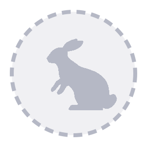
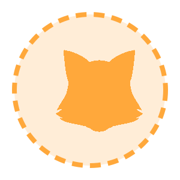
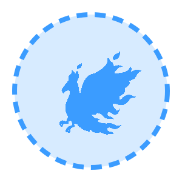
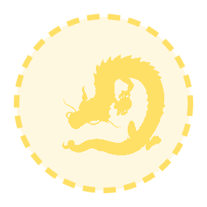
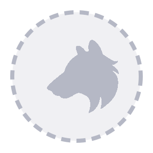
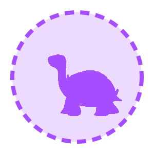

<div align="center">

<p>
  
  
  
  
  
  
  
</p>

# Octavious

**A Discord community bot that gives your server something to work toward.**

XP and prestige levels · 111 achievements · 18 collectible pets · unlockable name colours · staff tools

<p>
  
  
  
  
  
</p>

[Features](#features) · [Before you use it](#before-you-use-it) · [Quick start](#quick-start) · [Configuration](#configuration) · [Commands](#commands) · [Architecture](#architecture) · [Privacy](PRIVACY.md)

</div>

> [!IMPORTANT]
> **The source is public, but using it needs permission.** You're welcome to read the code. To run, host, copy or modify it, ask **mineprodan** first. See [Before you use it](#before-you-use-it).

---

## Features

<table>
<tr>
<td width="50%" valign="top">

### 📈 Levels & prestige
Members earn XP for chatting (one award per minute, so spam doesn't pay). XP scales with per-channel and server-wide multipliers. At **65,550 XP** a member prestiges: the level resets and the prestige number goes up. `/rank` draws a rank card with canvas.

</td>
<td width="50%" valign="top">

### 🏆 111 achievements
They come in 12 categories: XP, messages, streaks, channels, voice, social, time-based, hidden, ultra-rare and more. Progress is tracked live from messages, reactions, voice sessions, threads and events. `/achievements progress` shows how close you are to any one of them.

</td>
</tr>
<tr>
<td valign="top">

### 🐾 Collectible pets
There are 18 SkyBlock-style companions across six rarities, from Common to Divine. You feed them through the daily `/claim`, build bond, and evolve their XP perks. Pets have moods, nicknames, once-a-day tricks, and a small chance to be **shiny**. Neglect one for too long and it runs away.

</td>
<td valign="top">

### 🎨 Name colours
Colour role families unlock as members progress: Prestige 1–10, achievement milestones, rare achievement colours and booster colours. The hardest ones use gradients and holographic styles. `/color` lists them all with unlock progress.

</td>
</tr>
<tr>
<td valign="top">

### 🔥 Daily claim streaks
`/claim` pays 250 XP on day one, plus 50 XP for each day in your streak, up to 500. The reset happens at Pacific midnight. Admins can reset or restore streaks.

</td>
<td valign="top">

### 🛡️ Staff tools
Private **staff notes** on members (add, edit, remove and list, with autocomplete). `/snipe` and `/editsnipe` show the last deleted or edited message. AutoMod actions are logged, and bot logs are mirrored to a Discord channel.

</td>
</tr>
</table>

**Optional extras:** a YouTube feed that powers `/latest` and the bot's *"Watching …"* status. There's also a MongoDB job queue and hourly activity stats, so a companion web dashboard can drive the bot.

---

## Before you use it

This is **not** an open-source license. Under the [LICENSE](LICENSE), you need written permission from **mineprodan** before you run, host, copy, modify or redistribute any part of this code. You can ask by messaging **mineprodan** on Discord or by [opening an issue](https://github.com/MineProDan/octavious_open/issues).

Without permission, you can still read the code, and you can fork the repo to send a pull request.

The setup steps below are for people who have been given permission.

---

## Quick start

### Prerequisites

- **Node.js 22+**
- **MongoDB**, either local or a free [Atlas](https://www.mongodb.com/atlas) cluster
- A **Discord application** with a bot user ([developer portal](https://discord.com/developers/applications))

### 1. Create the bot

In the developer portal, open your app's **Bot** tab and turn on these privileged intents:

- ✅ Server Members Intent
- ✅ Message Content Intent

Invite the bot with the `bot` and `applications.commands` scopes. It needs **Manage Roles** (for colour roles), **Manage Server** (for AutoMod logging), and the usual read and send permissions.

### 2. Install and configure

```bash
git clone https://github.com/MineProDan/octavious_open.git
```

```bash
cd octavious_open && npm install
```

```bash
cp .env.example .env
```

Fill in `.env`. At minimum you need `DISCORD_TOKEN`, `CLIENTID`, `GUILDID`, `MONGODB_URI` and `MONGODB_DB`.

### 3. Register commands and run

```bash
node deploy_commands.js
```

```bash
npm start
```

### 🐳 Docker

The included `Dockerfile` registers slash commands and starts the bot:

```bash
docker build -t octavious .
```

```bash
docker run --env-file .env octavious
```

---

## Configuration

All configuration lives in environment variables. See [`.env.example`](.env.example) for the full list.

| Variable | Required | Description |
| --- | :---: | --- |
| `DISCORD_TOKEN` | ✅ | Bot token |
| `CLIENTID` | ✅ | Application (client) ID |
| `GUILDID` | ✅ | The server the bot runs in |
| `MONGODB_URI` | ✅ | MongoDB connection string |
| `MONGODB_DB` | ✅ | Database name |
| `DISCORD_LOG_CHANNEL_ID` | | Mirrors bot logs and errors to this channel |
| `DISCORD_LEVEL_LOG_CHANNEL_ID` | | Separate channel for XP and level-up logs |
| `WELCOME_CHANNEL_ID` | | Posts "*user* joined the server!" here |
| `ACHIEVEMENTS_GENERAL_CHANNEL_ID` | | Your main chat channel, used by some achievements |
| `ACHIEVEMENTS_CONFIGURED_CHANNEL_IDS` | | Comma-separated channels for the "post everywhere" achievement |
| `YOUTUBE_API_KEY` | | Enables the YouTube feed |
| `YOUTUBE_CHANNEL_IDS` | | Comma-separated YouTube channel IDs to watch |

### Customising

| What | Where |
| --- | --- |
| XP needed per level | [`xptolevel.csv`](xptolevel.csv) |
| Achievements | [`utils/achievements/definitions.js`](utils/achievements/definitions.js) |
| Pets, perks and unlock rules | [`utils/pets/catalog.js`](utils/pets/catalog.js) |
| Colour roles and unlock rules | [`utils/colorRoles/catalog.js`](utils/colorRoles/catalog.js) |
| Channel XP multipliers | `channelxpmult` collection: `{ channelId, value }` |

---

## Commands

<details open>
<summary><b>For everyone</b></summary>

| Command | What it does |
| --- | --- |
| `/rank [user]` | Canvas rank card with level, prestige and progress |
| `/level [user]` | Quick level check |
| `/achievements view` · `progress` | Browse achievements by category, or track one |
| `/pets view` · `equip` · `unequip` · `feed` · `evolve` · `play` · `nickname` | Look after your companions |
| `/color [role]` | Pick an unlocked name colour, or see how to unlock more |
| `/snipe` · `/editsnipe` | Show the last deleted or edited message in a channel |
| `/latest` | Show the newest video from the configured YouTube channels |

</details>

<details>
<summary><b>For admins</b></summary>

| Command | What it does |
| --- | --- |
| `/claim` | Daily streak reward *(currently admin-only while it's being tested; see `commands/utility/claim.js`)* |
| `/addxp` · `/removexp` | Adjust a member's XP (level and prestige are recalculated) |
| `/changeglobalxp` | Set the server-wide XP multiplier |
| `/claimreset` · `/claim-restore` | Reopen today's claims, or restore a member's streak |
| `/staffnoteadd` · `/staffnoteedit` · `/staffnoteremove` · `/staffnotes` | Private moderator notes on members |

</details>

---

## Architecture

```
├── index.js                 # Client setup, command/event loading, log mirroring
├── deploy_commands.js       # Registers slash commands for GUILDID
├── commands/utility/        # One file per slash command
├── events/                  # One file per Discord gateway event
├── utils/
│   ├── achievements/        # Definitions, evaluation engine, progress store, voice tracker
│   ├── pets/                # Catalog, mechanics (bond, mood, runaways), canvas renderer
│   ├── colorRoles/          # Colour catalog and role sync
│   ├── rank/                # Rank card renderer
│   ├── webJobs/             # MongoDB-backed job queue worker
│   ├── automod/             # AutoMod rule sync and event log
│   └── activityStats.js     # Hourly activity rollups
├── assets/fonts/            # Bundled fonts for canvas rendering
├── public/assets/pets/      # Pet artwork
└── test/                    # node:test suites (with an in-memory Mongo fake)
```

<details>
<summary><b>Web dashboard integration</b></summary>

The bot can share its MongoDB database with a web dashboard:

- **Job queue.** The site inserts jobs into `bot_jobs`. The bot polls every 2 seconds, runs one job at a time, and retries failures with backoff. Built-in job types:
  - `member.refresh` refetches a member's name and avatar, then recalculates level and prestige.
  - `automod.rule.save` and `automod.rule.delete` apply AutoMod rule changes made on the site.
- **AutoMod log.** Every AutoMod action is written to `automod_events`.
- **Activity stats.** Messages, reactions, voice minutes, commands, joins and leaves go into one `activity_hourly` document per UTC hour, kept for 400 days by a TTL index. There's also an hourly `activity_snapshots` entry.

</details>

---

## Development

```bash
npm test
```

The tests use Node's built-in test runner and an in-memory MongoDB fake, so you don't need a database or a Discord connection. CI runs them on every push and pull request.

## Contributing

Issues and pull requests are welcome, and you don't need permission to open one. Please run `npm test` before you open a PR, and add tests for new mechanics. By contributing, you agree to the contribution terms in the [LICENSE](LICENSE).

## Privacy

To see what data the bot collects and how to have it deleted, read the [Privacy Policy](PRIVACY.md).

## License

**Source-available. Permission is required to use it.** © 2026 mineprodan. All rights reserved. See [LICENSE](LICENSE).

The bundled fonts are under the SIL Open Font License; see [`assets/fonts/README.md`](assets/fonts/README.md).
